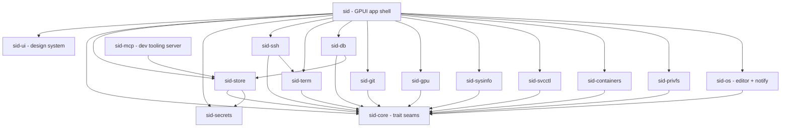

# sid architecture

How the pieces fit, and the exact files to touch for the common changes. State per tab and
landmines live in [`HANDOFF.md`](HANDOFF.md); binding rules in [`../CLAUDE.md`](../CLAUDE.md).

## Crate graph

Edges derived from each `crates/*/Cargo.toml` (`sid-X --> sid-Y` = X depends on Y).
`sid-core`, `sid-secrets` and `sid-ui` depend on no other sid crate.

Rule of thumb: arrows point at `sid-core` (traits). Only `sid` sees concrete types, and it
names them in a handful of composition points (below). `sid-db -> sid-store` exists only
for the read-only `RedbBrowseClient` over an opened `GlobalStore`. `sid-mcp` is not part of
the app: it is a stdio MCP server for working on this repo (`.mcp.json`), depends only on
`sid-store` (read-only, for `store_inspect`) and never names gpui or an adapter crate.

## Seam table

Trait (owned by `sid-core` unless noted) -> impl crate -> where the app constructs it.

| Trait | Impl (crate) | Wired in `crates/sid/src/` |
|:--|:--|:--|
| `ssh::SshClient` (+ `SftpSession`, `SshShellReader/Writer`) | `RusshClient` / `RusshClientFactory` (`sid-ssh`) | `ui/session.rs` (`RusshClientFactory::new(known_hosts_path)`) |
| `term::TerminalScreen` | `Vt100Screen` (`sid-term`) | `ui/session.rs` (`Box::new(Vt100Screen::new(..))`) |
| `keys::IdentityScan` | `LocalIdentities` (`sid-ssh`); `StaticIdentities` is the core test double | `ui/host_form.rs` (`LocalIdentities::from_env()`) |
| `db::DbClient`, `db::DbClientDescriptor` | `PostgresClient`, `SqliteClient`, `RedbBrowseClient`, `*Descriptor` (`sid-db`) | `db_registry.rs` (`DbRegistry`, one `register(factory, descriptor)` per `DbKind`) |
| `git::GitProvider` | `Git2Provider` (`sid-git`); fetch/push of network remotes shell out to the `git` CLI (`crates/sid-git/src/cli.rs`: argv only, non-interactive env, 90 s timeout, process-group kill, capped output), local remotes stay on libgit2 | `git_registry.rs` (`Git2Provider::factory()`) |
| `sys::SysProvider` | `SysinfoProvider` (`sid-sysinfo`) | `ui/network_tab.rs`, `ui/systems_tab.rs` |
| `svc::ServiceProvider` | `SvcctlProvider` (`sid-svcctl`) | `ui/network_tab.rs` |
| `containers::ContainerProvider`, `KubeProvider` | `DockerCliProvider`, `KubectlCliProvider` (`sid-containers`) | `ui/network_tab.rs` |
| `privfs::PrivilegedFs` | `SudoPrivilegedFs` (`sid-privfs`) | `ui/config_editor.rs` (a `OnceLock`'d `Arc<dyn PrivilegedFs>`) |
| `editor::EditorLauncher` (+ `EditorHandle`, `LaunchPolicy`) — `sid_core::editor` | `LinuxEditorLauncher` (`sid-os`: `$VISUAL`/`$EDITOR`, terminal vs GUI, `xdg-open` fallback) | not yet wired in `crates/sid` (lands with SFTP edit-in-place) |
| `notify::Notifier` — `sid_core::notify` | `DbusNotifier` (`sid-os`, `org.freedesktop.Notifications` via zbus) | `app.rs` (`AppState::notifier: Arc<dyn Notifier>`) |
| `gpu::GpuPreflight` | `LinuxGpuPreflight` (`sid-gpu`) | `main.rs` (before gpui starts) |
| `sid_secrets::SecretStore`, `KeyringBackend` (owned by `sid-secrets`) | `KeyringStore<OsKeyringBackend>`, `MemorySecretStore`, dormant `EncryptedFileStore` | `app.rs::open_secrets` -> `AppState::secrets: Box<dyn SecretStore>` |

`main.rs` is the composition root for the window: GPU pre-flight, `Store::open`,
`open_secrets`, then `AppState::new(..)` inside `gpui_component::Root` (the only file in
`crates/sid` allowed to name `gpui_component`). `SID_GALLERY=1` mounts
`sid_ui::gallery::Gallery` instead.

## Runtime model

- **One `AppState` entity** (`app.rs`) owns everything: active `Tab` (6 variants,
  `Tab::ALL`), per-tab state structs (`ui/*_tab.rs`), the `Store`, `secrets`, modals,
  `root_focus`. Single process, single window.
- **Render from cache.** `AppState::render` (and each `*_tab` render fn) reads only
  already-fetched state. **No I/O in `render`** — ever (HANDOFF "Key files").
- **I/O only in event handlers / background executors.** Handlers spawn onto the shared tokio
  handle `ui::session::ssh_runtime()` (or a gpui background executor), then update the entity
  with the result and `cx.notify()`. `sid-svcctl`/`sid-containers` use `tokio::process`
  for exactly this reason (they only run inside such spawned tasks).
- Keyboard: `keymap.rs` (`Action`, `ALL_ACTIONS`, `default_bindings()`) is pure and
  gpui-light; user overrides are `KeyBinding`s in the store. `ui::init` binds form-scoped keys.
- Pre-gpui startup (`--gpu-probe`, `--gpu-report` argv modes) runs before anything touches
  the store or secrets.

## Store: layering, attribution, secrets-by-ref

`sid-store::Store` (`store.rs`) is the facade over two layers:

- `GlobalStore` (`global.rs`): redb, always loaded. Values are `postcard` via
  `codec::encode_versioned(version, &v)` — a leading version byte, decoded by
  `decode_host` / `decode_connection` / `decode_settings` which chain old shapes
  (`HostV1 -> HostV2 -> Host`, ...). Consts: `HOST_VERSION`, `CONNECTION_VERSION`,
  `SETTINGS_VERSION`.
- `WorkspaceStore` (`workspace.rs`): committed `.sid/config.toml` (`WorkspaceConfig`),
  git-diffable, never redb.
- `composer.rs::compose` returns the **union**, each item `Attributed` by `Scope`
  (`Global | Workspace(WorkspaceId)`); `ViewFilters` (collapse duplicates, hide-global)
  are view-only over a lossless store. Promote/demote refuse with `StoreError::Conflict`
  rather than overwrite.
- **Secret bindings** (`secret_bindings` redb table in `GlobalStore`; `SECRET_BINDING_VERSION`):
  every stored secret is bound to the layer and the endpoint fingerprint it was saved for.
  `crates/sid/src/secret_binding.rs::fetch` only returns a secret to a record that still has
  that layer and endpoint (else `Bound::Withheld` and a re-prompt); workspace secrets are
  keyed per workspace. Bindings live in the uncommitted global store, never in TOML.
- Secrets: records hold only an opaque `SecretId` (`secret_ref`); bytes live behind
  `sid_secrets::SecretStore`. `crates/sid-store/tests/secret_boundary.rs` guards that no
  secret reaches redb/TOML. Unknown SSH host keys are refused by `sid-ssh`
  (`SshError::HostKeyUnknown`) until the user picks "Trust and connect"
  (`crates/sid/src/ui/host_key_prompt.rs`).

## Recipes

### Add a tab
1. `crates/sid/src/ui/<name>_tab.rs` with a `<Name>TabState` (cache + fetch handlers) and a
   render fn; add `pub mod <name>_tab;` in `crates/sid/src/ui/mod.rs`.
2. `crates/sid/src/app.rs`: add a `Tab` variant and extend `Tab::ALL` (array length!), `label()`,
   `icon()` (icons must be unique — a test enforces it), `tab_from_str` (`SID_START_TAB`), the
   render `match` (near `Tab::Workspaces => self.workspaces_tab(..)`), and the state field on `AppState`.
3. `crates/sid/src/keymap.rs`: `PrimaryTab(n)` already covers 1..=6 — widen the range in
   `ALL_ACTIONS`/`default_bindings`/`Action::label` for a 7th tab; keep the "unbound index" tests green.
4. `scripts/sid-cap.sh` header/`--tab` docs list the tab names; `tab_from_str` is what actually parses `SID_START_TAB`.
5. Build only from `sid_ui` components; capture all four themes (`sid-capture` skill).

### Add an adapter (new external lib / OS integration)
1. Trait + domain types in `crates/sid-core/src/<area>.rs`; `pub mod <area>;` in
   `sid-core/src/lib.rs`. No concrete dependency may enter `crates/sid-core/Cargo.toml`.
2. New crate `crates/sid-<x>/` (add to root `Cargo.toml` `members` and `[workspace.dependencies]`),
   depending on `sid-core` only; the concrete lib is named only here. Prefer `tokio::process`
   for CLI shells; stateless where possible.
3. Wire in `crates/sid/Cargo.toml` + one construction site in `crates/sid/src/` (a `*_registry.rs`
   module like `db_registry.rs`/`git_registry.rs` for factories, or the tab that uses it).
   Everything downstream takes `Arc<dyn Trait>`/`Box<dyn Trait>`.
4. Hygiene: `.claude/hooks/adapter-violation.sh` forbidden-crate list (add the new lib to the
   `sid-core` list); `crates/sid-ui/tests/hygiene.rs` if it is a new GPUI-adjacent crate.
5. Tests: unit tests in the impl crate against a fake; a `tests/` integration test; mark
   Docker-dependent ones `#[ignore]` and add a `scripts/test-*.sh` driver.

### Add a stored entity field (postcard versioning)
1. `crates/sid-store/src/entities.rs`: freeze the *current* struct as `<Entity>V<N>` (keep
   it; derive `Deserialize`), add the field to the live struct with `#[serde(default)]`
   — **never** `skip_serializing_if` (postcard is positional) — and `impl From<<Entity>V<N>>`.
2. `crates/sid-store/src/global.rs`: bump `<ENTITY>_VERSION`, add a `decode_*` match arm
   for the old version that converts through `From`, keep every older arm.
3. Re-export new `V<N>` types in `sid-store/src/lib.rs` if tests need them.
4. Tests: in `crates/sid-store/tests/global.rs` (or `roundtrip.rs`) write an old-version
   blob with `encode_versioned(<old>, &old_value)` into the table and assert it reads back
   migrated with defaults. If the entity is also in workspace TOML, the field needs
   `#[serde(default)]` there too (`workspace.rs`). Use the `sid-store-migration` skill.

### Add a keybinding / action
1. `crates/sid/src/keymap.rs`: add a variant to `Action`; give it `id()` (stable string),
   `label()`, and list it in `ALL_ACTIONS` (a test checks ids are unique and round-trip).
2. Add a `binding(chord(..), BindingContext::{Global|NormalOnly|TerminalOnly}, Action::X)` in
   `default_bindings()`; letter accelerators need both Normal and Terminal contexts
   (see `CommandPalette`). `default_bindings_have_no_conflicts` must stay green.
3. If rebindable, its key must be in `REBINDABLE_KEYS`; `resolve_rebind` handles conflicts.
4. Handle the action in the dispatch `match` in `crates/sid/src/app.rs` (see `Action::CommandPalette => self.toggle_palette(..)`), and surface it
   in `ui/command_palette.rs` if it should be palette-reachable.

### Add a `sid-ui` component
1. `crates/sid-ui/src/<name>.rs` (a `RenderOnce`/builder; colours from `theme::active(cx)`
   tokens only, text via typography roles `.text_body(&t)` etc., one-line text with
   `.clamp_one_line()`); `pub mod <name>;` + `pub use` in `crates/sid-ui/src/lib.rs`.
2. Show **every variant and state** in `crates/sid-ui/src/gallery.rs` (add to `buttons`/`chips`/
   `structure` or a new section fn). View it: `SID_GALLERY=1 scripts/sid-cap.sh --out ..`
   (or `just gallery`).
3. Hygiene (`crates/sid-ui/tests/hygiene.rs`): no raw hex (except `bridge::SCRIM`), no raw
   `text_xs()/text_sm()/text_size()/font_weight()/font_family()`, no `.truncate(`, no emoji.
   If wrapping a gpui-component widget, thread it through `bridge.rs` or it renders unthemed.
4. Callers in `crates/sid` use the `sid_ui` re-export, never `gpui_component::`.

## Testing

Gate and commands: root `CLAUDE.md` / `just gate`. Per-crate unit and integration tests;
`#[ignore]`d Docker tests via `just test-ssh` / `just test-db`; captures via `scripts/sid-cap.sh`.

**UI interaction tests** (`just ui-test`): `gpui-kit` is a dev-dependency of `sid-ui` only; its
`TestWindowExt` (`find/click/press/input/hover`) drives a real headless window with no compositor.
Tests live in `crates/sid-ui/tests/` (`button_activation`, `focus_trap`, `text_input_editing`,
`tree_keyboard`, `fill_table_floor`) on the shared `tests/common/mod.rs`. They assert
focus, keys, clicks and geometry — not pixels or colour (that stays with `sid-cap.sh`).
Details in `crates/sid-ui/CLAUDE.md`.
